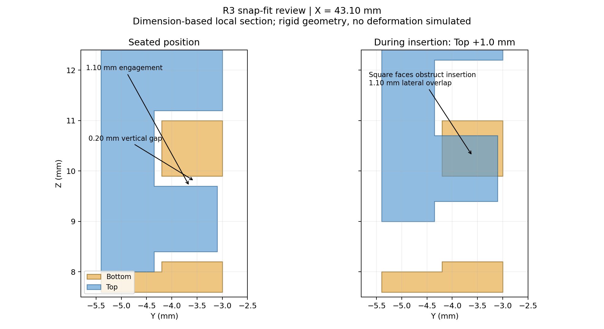

# R3 Top / Bottom 접합 및 스냅핏 검토

검토일: 2026-09-16. 대상: Case_Bottom_R3_round_copy.FCStd 및 Case_Top_R3_round_copy.FCStd. 파일에 저장된 공통 좌표계와 Placement 그대로 사용. 원본 수정 없음.

## 판정

외곽 접합 단차와 안착 상태의 체적 간섭은 발견되지 않았다. 스냅핏은 안착 시 위치가 맞지만, 사각 돌기와 사각 수용부로 인해 수직 삽입성이 검증되지 않았다. 따라서 전체를 '문제 없음'으로 판정할 수 없다.

## 실제 형상 측정 (mm)

- 두 부품 각각 유효한 단일 솔리드. Bottom 946 faces, Top 4078 faces.
- 전체 두 솔리드 Boolean common: 체적 0 mm³, 교차 솔리드 0.
- 접합 기준 Z=8.000. 양쪽 외곽 X=-5.000/91.650, Y=-5.400/60.400 일치. 네 외곽 코너 R=3.000 및 원호 위치 일치. 명목 외곽 단차 0.
- Bottom 안내턱 외측 X=-3.800/90.450, Y=-4.200/59.200.
- Top 수용부 내측 X=-3.950/90.600, Y=-4.350/59.350. 직선 구간 편측 간극 0.150.
- 대응하는 네 코너 원통면의 최소 거리 각각 약 0.153569. 곡선 구간은 직선 구간과 같은 일정 오프셋이 아니다.
- Bottom 안내턱 상단 Z=11.000 / Top 수용부 천장 Z=11.200: 높이 간극 0.200.
- 전면 X=4..20 개구는 연속 접합선에서 제외되는 형상이다.

## 스냅핏 네 곳

| 위치 | Top 돌기 X | Bottom 슬롯 X |
|---|---|---|
| 전면 1 | 40.60..45.60 | 40.45..45.75 |
| 전면 2 | 64.60..69.60 | 64.45..69.75 |
| 후면 1 | 16.60..21.60 | 16.45..21.75 |
| 후면 2 | 64.60..69.60 | 64.45..69.75 |

모두 돌기 폭 5.00, 슬롯 폭 5.30, 좌우 간극 각각 0.15. 돌기 Z=8.40..9.70, 슬롯 Z=8.20..9.90으로 위아래 간극 각각 0.20.

전면 돌기 Y=-4.35..-3.10, Bottom 벽 Y=-4.20..-3.00. 후면 돌기 Y=58.10..59.35, Bottom 벽 Y=58.00..59.20. 네 곳 모두 벽 두께 방향 걸림 중첩 1.10, 돌기 끝은 내부 벽 기준 0.10 후퇴. 이 0.10은 막힌 슬롯 바닥 간극을 뜻하지 않는다.

안착 위치에서 돌기와 슬롯은 간섭하지 않는다. 다만 걸림 상면이 접촉하기까지 Top이 +Z 방향으로 0.20 움직일 수 있으므로 명목상 들뜸 여유가 있다. 예압 및 실제 마찰은 검토하지 않았다.

## 삽입 경로의 문제

돌기 및 수용부 상단에 삽입을 유도하는 경사면/라운드가 없다. 돌기는 독립적으로 절개된 긴 탄성 암이 아니라 케이스 벽에 연결된 직사각 돌기다. 따라서 케이스 벽의 변형 또는 별도의 벌림 조작이 필요하다.

전면 1번 국부 형상을 잘라 Top을 Z로 이동한 강체 Boolean 검사:

| 안착점 대비 Top +Z (mm) | 국부 교차 체적 (mm³) |
|---|---|
| 0 | 0 |
| 0.2 | 0 |
| 0.5 | 1.65 |
| 1.0 | 4.40 |
| 1.5 | 6.05 |
| 2.0 | 3.30 |
| 2.6 | 0 |
| 3.0 | 0 |

이 교차는 스냅핏 삽입 과정에서 피해야 하는 중첩이며 안착 상태의 오류와 구분해야 한다. 통과하려면 해당 위치에서 두 부품 사이에 약 1.10 mm의 상대 측방 변위가 필요하다. 이는 한 부품만 1.10 mm 변형해야 한다는 뜻은 아니다. 네 돌기의 동일한 직사각 단면에서 같은 기하학적 문제가 적용된다. 전체 조립 경로 및 탄성 해석은 수행하지 않았다.

권장 검토 방향: 삽입 유도 경사/라운드, 탄성 변형 길이와 루트 형상, 필요한 걸림량을 함께 재설계. 재질, 제작 공정 및 공차가 없으므로 확정 수정치·삽입력·유지력·반복 수명은 제시하지 않는다. 재료별 허용 변형률과 형상이 스냅핏 허용 변위를 결정한다는 근거: [Covestro Snap-Fit Joints for Plastics](https://www.covestro.com/-/media/covestro/solution-center/brands/downloads/imported/1556891135.pdf?hash=7876F8D5E2C7244C33BEAA0DDC6C20F6&rev=2375d9db07bd48b19949b705c884423b).

명목 CAD 정렬과 실제 생산품의 무단차는 별개다. XY 편측 0.15 및 Z 0.20의 여유가 실제 공차·변형을 수용하는지는 제작 조건 및 시제품으로 확인해야 한다.

